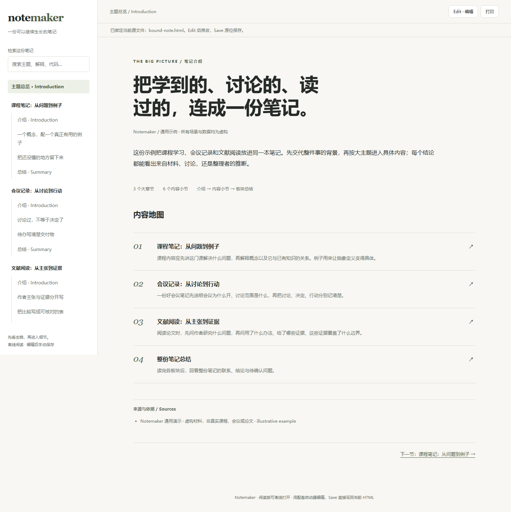

# Notemaker

**[中文](README.md) · [English](README.en.md)**

Create substantial visual notes from real sources. Click **Edit** for notebook-style cells; click **Save** to write back to the currently bound HTML.

Inputs may be documents, PPTX decks, courses, minutes, papers, search findings, or model-authored material. Structure follows the source rather than a fixed Day-by-Day curriculum. Every section uses **introduction → content subsections → a final summary subsection**.



## Substantive introductions and summaries

Introduce the concrete context/problem, relationships between concepts, and reading route. Closing summaries connect the material, compare methods or discussion status, retain evidence/limitations, and identify useful next checks. Complex sections need developed paragraphs and relevant tables/figures, not a one-sentence slogan. Adapt depth to the source rather than padding to a universal word count.

Meetings distinguish discussion, suggestions, confirmed matters and actions. Papers distinguish author claims, evidence, limitations and model inferences. Courses explain concepts through examples. Retain source locations and never invent owners, deadlines or experimental values.

## Notebook-style editing

- Cell controls appear only after Edit.
- Introduction, body and summary cells support insertion above/below, editing, duplication, reordering, deletion, clearing and restarting.
- Text/figure cells offer visual editing and optional HTML source editing. Code cells are text editors and **never execute code**.
- Add/delete/reorder sections and topics, embed local images, and customize titles/theme/accent/font size.
- Cancel restores the pre-edit draft. Nothing autosaves.

## Save writes to the current source

The paired launcher binds the existing HTML. Save backs up the previous bytes, atomically writes the same path, verifies the result, and only then acknowledges success. No file picker or repeated location choice.

A **Python standard-library local service** enables this. It binds only loopback and one file, checks session/origin/model and file revision, and preserves drafts on conflicts or failures. Backups live in `.notemaker-backups/`.

Opening the standalone HTML still supports offline reading/editing. Browsers cannot silently overwrite that file in every configuration, so Save in file:// mode explains how to open the paired launcher. Explicit **Export copy** remains a separate download action, not an imitation of in-place saving.

## Install and run

Copy `skills/notemaker/` to `~/.codex/skills/notemaker/`, or download the skill archive from Releases.

> Use $notemaker to read these slides, minutes or papers. Develop each section's introduction, then the details, then its synthesis. Retain evidence and provide editable cells with one-click in-place saving.

```sh
python skills/notemaker/scripts/build_note.py note.json --output note.html
python skills/notemaker/scripts/serve_note.py note.html --create-launchers
python skills/notemaker/scripts/serve_note.py note.html
```

Double-click the generated Windows `.cmd` or macOS/Linux `.command`, or use the last command directly. Keep its terminal open; Ctrl+C stops it. Requires Python 3.10+ for editing with in-place saving. The standalone reader requires no environment. Move HTML, launcher and `_notemaker_runtime/` together. Providing a portable launcher is not evidence of testing macOS.

## Source reading and later updates

The AI using the skill reads, verifies and explains sources; the generator does not call an AI API. Helpers retain input provenance:

```sh
python skills/notemaker/scripts/read_material.py lecture.pptx --output extracted.json
python skills/notemaker/scripts/build_note.py edited-note.html --extract recovered.json
```

Supports PPTX, PDF, HTML, Markdown and text. PDF extraction needs pypdf or another reader; PPTX text extraction does not prove images/layout/image equations were inspected. Legacy `.ppt` needs real conversion. Recover the latest saved HTML rather than overwriting user edits from stale JSON.

The public example is fictional interface material. External-source cases and private notes are not redistributed in this repository. Real tests should record source, extraction scope and observed results; a fictional demo does not prove a paper/deck was read.

## Verification

```sh
npm ci
npx playwright install chromium
python skills/notemaker/scripts/build_note.py examples/general-note.json --output examples/general-note.html
python -m unittest discover -s tests -p test_server.py
npm test
```

Tests use actual temporary HTML files and local services: same-path writes/reopen/backups, cell operations, conflicts, failed writes, access boundaries, image/appearance retention, explicit exports and mobile layout. Atomic-replace failure has an independent test. External/private cases run only where their files exist; CI explicitly skips them rather than claiming they ran remotely.

Entry points: `SKILL.md`, `scripts/build_note.py`, `scripts/serve_note.py`, `scripts/read_material.py`, `assets/notebook.js`, `assets/app.js`. See [the local-saving contract](skills/notemaker/references/local-saving.md).
