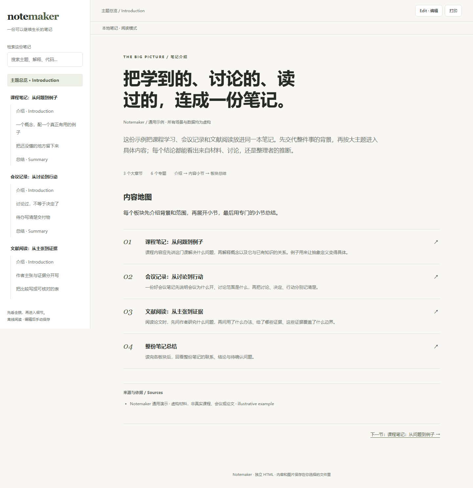

# Notemaker

**[中文](README.md) · [English](README.en.md)**

把材料变成先讲全貌、再讲细节的可视化笔记。离线打开，直接编辑，手动保存成真正的本地 HTML。

Notemaker 是一个可安装的 AI skill，附带无需前端框架的笔记生成器。输入可以是文档、PPT、课程材料、会议记录、论文、用户笔记、搜索结果，或模型自己的总结。它不预设某个学科，也不要求所有内容都按“第几天”组织。



## 它生成什么

- **整份笔记先有介绍和内容地图，最后再做整体总结**，不直接从细碎小节开始。
- **每个板块遵循「介绍 → 内容小节 → 最后一个总结小节」**。介绍讲背景、范围与问题，总结在展开内容之后梳理联系、结论和待确认事项。
- 板块可以是课程模块、会议议题、文献主题或项目部分；名称和总结方式随材料调整，Day 01/Day 02 只是一种例子。
- 按大章节/小节浏览，全文搜索、图片放大、代码、表格、打印和窄屏目录。
- 区分材料事实、模型整理和待确认内容，保留可用来源与页码/幻灯片/时间位置。
- Edit 后可改标题、简介、总结、正文、代码和图注，新增章节/小节、插入本地图片，调整主题、强调色和字号。
- 单个 HTML 内嵌内容、图片、CSS 和 JavaScript，阅读和编辑无需服务器、账号、CDN 或联网。

## Save 真的保存在哪里？

**不会把 localStorage 或“已保存”提示当作落盘。**

| 浏览器能力 | 点击 Save 的结果 |
| --- | --- |
| 支持文件保存 API 且允许使用 | 第一次选择本地目标文件；写入并关闭文件流成功后才显示成功。同一页面会话可继续保存到同一文件。重开页面后需重新选择。 |
| 不支持该 API | 下载一份包含全部修改的新 HTML。页面会明确提示“已请求下载，请重新打开核对”，不会声称覆盖了原文件。 |
| 用户取消、拒绝权限或写入失败 | 修改留在当前页面，保持未保存状态；可重试或下载 HTML 副本。 |

这是独立 HTML 的浏览器边界：它不能在所有浏览器中不经授权直接覆盖自身文件。Safari/Firefox 等不支持直接选文件的配置仍可导出完整 HTML，用户可在文件系统中替换旧文件。没有自动保存；Cancel 会放弃本轮编辑。下载是否完成不能被页面可靠获知，所以导出后当前页仍保留未保存提醒。

## 安装 skill

将本仓库的 `skills/notemaker/` 目录复制到 `~/.codex/skills/notemaker/`。如果当前 AI 有 GitHub skill 安装工具，也可提供仓库地址和这个子目录。

调用示例：

> 用 $notemaker 把这份 PPT 和我的课堂笔记整理为可视化 HTML。每个模块先做介绍，再展开例子，最后一个小节总结；保留来源，允许我编辑后保存到本地。

> 用 $notemaker 整理这份会议记录。区分讨论、决定、行动与待确认事项，没有负责人或期限不要编。

> 用 $notemaker 综合这些文献和你检索到的资料，按问题、方法、证据和局限组织；把模型推断标出来。

## 生成器与示例

生成器只需要 Python 3.10+ 标准库；不需要 Node。浏览器可以直接打开生成文件。

```sh
python skills/notemaker/scripts/build_note.py examples/general-note.json --output examples/general-note.html
```

打开 `examples/general-note.html` 即可体验。该示例的课程、会议、文献内容均为虚构说明，不引用用户私人笔记。

模型应先读取真实材料，再按 [内容结构](skills/notemaker/references/content-and-schema.md) 写出笔记模型；生成器负责封装，不会自行读取 PPT、联网搜索或调用模型。那些工作由使用 skill 的 AI 完成。

用户在浏览器保存过之后，再交给 AI 更新时，应提取已保存 HTML 中的最新内容：

```sh
python skills/notemaker/scripts/build_note.py edited-note.html --extract recovered.json
```

不要直接从旧 JSON 重建而丢掉用户修改。所有输出本地路径由使用者决定；构建时 `asset:相对路径` 图片会被内嵌。数值图应基于数据绘制，不用生成式图片伪造。

## 开发和验证

```sh
npm ci
npx playwright install chromium
npm test
```

测试覆盖真实 HTML 下载、重开验证、图片/代码/设置保留、编辑取消、搜索、章节简介、窄屏，以及模拟文件句柄的成功/取消/写入失败/关闭失败/重复保存。模拟测试不等于真实系统文件选择器或 macOS/Safari 已实测。运行时不加载未审核的源 HTML 脚本、事件属性或远程图片。

核心结构：`skills/notemaker/SKILL.md`（工作流）、`references/`（内容/保存约定）、`scripts/build_note.py`（构建/提取）、`assets/`（离线界面和编辑保存运行时）、`examples/`（虚构示例）、`tests/`（行为测试）。

文件保存 API 依据：[showSaveFilePicker](https://developer.mozilla.org/en-US/docs/Web/API/Window/showSaveFilePicker)、[createWritable](https://developer.mozilla.org/en-US/docs/Web/API/FileSystemFileHandle/createWritable)、[download](https://developer.mozilla.org/en-US/docs/Web/API/HTMLAnchorElement/download)。
